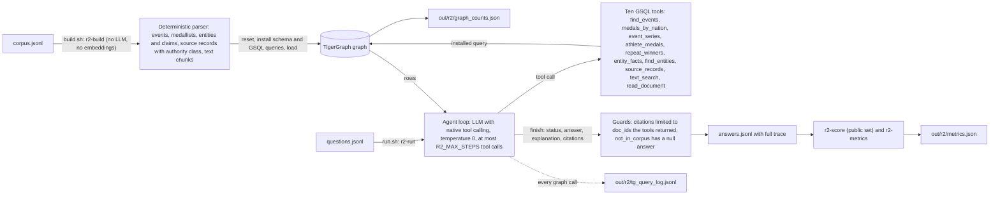

# TigerGraph Agentic GraphRAG

An agentic GraphRAG system for the Round-2 brief: it takes a natural-language question about a 3,530-document corpus (Olympic event articles, film and politician pages, and 39 dated source records of mixed reliability), plans its own steps, queries a **TigerGraph** graph through ten installed GSQL queries, and returns a cited answer with a status (`answered`, `partial` or `not_in_corpus`), a short explanation, token and latency accounting, and a complete trace of every step. The corpus is the only source of truth; when the evidence is missing, provisional or in conflict, the answer says so instead of guessing.

Everything is reproducible with `./build.sh` and `./run.sh` (see [Round 2: build, run, submit](#round-2-build-run-submit)). The organisers' brief is in [`docs/round-2/PROBLEM-STATEMENT.md`](docs/round-2/PROBLEM-STATEMENT.md).

## Architecture



Round 2 adds the `ogr.r2` package, the `r2_*` GSQL queries and the two scripts. The Round-1 code (three-pipeline comparison, web UI) is still in the repository and shares only the graph schema, the loader and the LLM client.

## How each scoring criterion is met

| Criterion (weight) | What the system does | Where to look |
|---|---|---|
| Accuracy (40%) | The corpus is parsed once, deterministically, into a typed graph (events, medals per athlete, entities and claims, source records). Counting, ranking, series and list questions are answered by GSQL queries over that structure, not by reading text. The LLM plans which tools to call and writes the answer from their rows. Prompt rules are general (complete lists, authority over recency, provisional is not final). | `backend/src/ogr/r2/agent.py`, `tools.py`, `backend/src/ogr/graph/queries/r2_*.gsql` |
| Honesty (10%) | Three statuses. `not_in_corpus` forces a `null` answer; an empty answer becomes `not_in_corpus`; an unknown status becomes `partial`. Citations are kept only if a tool returned that `doc_id` during the question. Absence of evidence is not treated as a negative fact. | `agent.py` (`_finalize`) |
| Evidence (10%) | Every answer carries the `doc_id`s that support it, plus a trace step per tool call with the query name, parameters and row count. Every TigerGraph call is also a timestamped line in `out/r2/tg_query_log.jsonl`. | `trace.py`, `querylog.py`, `scripts/validate_submission.py` |
| Repeatability (15%) | `build.sh` and `run.sh` at the root, locked dependencies in `backend/requirements.lock`, every key in `.env.example`, temperature 0, fixed tool order, a resumable run, and a git tag for the submitted code. A reproduced answer can be compared with the submitted one for any `qid`. | [`docs/round-2/LIVE-JUDGING.md`](docs/round-2/LIVE-JUDGING.md) |
| Efficiency (10%) | Token counts come from the provider's usage fields for every LLM call (an estimate is marked in the trace when a provider reports none) and sum exactly to the answer totals (the validator checks it). Tool results are trimmed before they go back to the model (empty and repeated fields dropped, at most 60 rows, long text cut at 2,000 characters, 24k characters in total, truncation stated). Retrieval is graph queries, so no embedding calls are made. | `tools.py` (`compact_result`), `metrics.py` |
| Live judging (15%) | One command to answer any new question on the live graph (`r2-run`, the `/round2` page or `POST /r2/ask`). | [`docs/round-2/LIVE-JUDGING.md`](docs/round-2/LIVE-JUDGING.md) |

The numbers of the submitted runs (accuracy of the public set by our own scorer, tokens, latency, LLM calls and TigerGraph queries per question, cost) are in `submission/round-2/metrics.json`; this README repeats none of them.

## Round 2: build, run, submit

**1. Setup.** Copy `.env.example` to `.env` and fill in the TigerGraph and LLM values, then install the locked dependencies (Python 3.11+):

```bash
cp .env.example .env     # then edit: TG_HOST, TG_* credentials, LLM_*
python3 -m pip install -r backend/requirements.lock && python3 -m pip install --no-deps -e backend
```

**2. Build.** Load the corpus into TigerGraph. This **resets** the graph named by `TG_GRAPHNAME`, installs the schema and the `r2_*` queries and writes `out/r2/graph_counts.json`. The TigerGraph user needs rights to create a graph and install queries.

```bash
./build.sh docs/round-2/data/corpus.jsonl
```

**3. Run.** Answer each question set. `run.sh` answers, self-scores the public set (`r2-score`) and updates `out/r2/metrics.json` (`r2-metrics`); the set is inferred from the questions file name.

```bash
./run.sh docs/round-2/data/questions_public.jsonl answers_public.jsonl
./run.sh docs/round-2/data/questions_hidden.jsonl answers_hidden.jsonl
```

That is six commands from a clean checkout. `run.sh` resumes an existing answers file (`FRESH=1` starts clean). Both scripts run from any directory and load `.env`. The hidden file is read only to be answered.

Individual steps (flags checked with `--help`):

```bash
python3 -m ogr.cli r2-build --corpus docs/round-2/data/corpus.jsonl --counts out/r2/graph_counts.json
python3 -m ogr.cli r2-run --questions q.jsonl --out answers.jsonl [--qids A,B] [--limit N] [--query-log PATH]
python3 -m ogr.cli r2-score --questions docs/round-2/data/questions_public.jsonl --answers answers_public.jsonl [--split dev|check]
python3 -m ogr.cli r2-metrics --set public --answers answers_public.jsonl --questions docs/round-2/data/questions_public.jsonl
python3 scripts/validate_submission.py --help      # checks answer files, metrics, query log and counts against the brief
```

`r2-run --backend local` runs the tools over an in-process copy of the corpus. It is for development and tests only: its steps carry `tigergraph: false` and it writes no query log.

| Output | What it is |
|---|---|
| `answers_public.jsonl`, `answers_hidden.jsonl` | One JSON answer per question with its full trace (written as the code runs) |
| `out/r2/metrics.json` | Metrics of both sets, recomputed from the answer files only (`metrics_notes.json` lists defaults used) |
| `out/r2/tg_query_log.jsonl` | One line per TigerGraph call: `ts, run_id, qid, step, query, params, rows, ms, ok, error` |
| `out/r2/graph_counts.json` | Vertex and edge counts by type after the build |
| `out/r2/score_public.json` | Per-question public scores from our own fact-level scorer (`ogr.r2.score`) |
| `docs/round-2/data/public_split.json` | Deterministic `dev` / `check` split of the public 50, by question style |

The checklist of the seven required deliverables is in [`docs/round-2/SUBMISSION.md`](docs/round-2/SUBMISSION.md).

**Demo.** Start the API and the UI, then open the "Round 2 agent" page at `http://localhost:5173/round2` (or call `POST /r2/ask` with `{"question": "...", "backend": "tigergraph"}`; `GET /r2/status` reports `"schema_installed": true` when the queries are installed):

```bash
python3 -m uvicorn ogr.api.main:app --app-dir backend/src --host 127.0.0.1 --port 8000
cd frontend && npm ci && npm run dev
```

## Round 2 architecture

**Documents to graph data** (`ogr.r2.corpus_model`, `ogr.r2.build`; design in [`docs/round-2/SOLUTION-DESIGN.md`](docs/round-2/SOLUTION-DESIGN.md)). `r2-build` parses the corpus deterministically (no LLM, no embeddings), resets the graph, installs the schema and the `r2_*` GSQL queries, and loads: documents and text chunks; Olympic events, Games, sports and venues from the infobox; athletes with `WON` edges (medal, NOC) from the medallist fields; the dated LA 2028 source records with an authority class (`official`, `operational`, `secondary`, `unreliable`) taken from the `Source:` line and `REPORTS_ON` links to the events they mention; and, for every other infobox (films, office holders, people), one entity with one claim per field. Vertex and edge counts are written to `out/r2/graph_counts.json`.

**Tools** (`ogr.r2.tools`). Ten read tools, each one installed GSQL query: `find_events`, `medals_by_nation`, `event_series`, `athlete_medals`, `repeat_winners`, `entity_facts`, `find_entities`, `source_records`, `text_search`, `read_document`. Two local helpers are recorded as non-TigerGraph steps: `rank_rows` (sorts an earlier result) and `finish`. Parameters and row shapes: [`docs/round-2/TECHNICAL-SPEC.md`](docs/round-2/TECHNICAL-SPEC.md) section 2.

**How the agent decides** (`ogr.r2.agent`). A short general system prompt and the question go to the chat model with native tool calling at temperature 0 (`R2_TOOL_MODE=text` switches to prompt-based JSON tool calls for models without it). The model picks tools, sees the results, and calls `finish` with `status`, `answer` (text or JSON), `explanation` and `citations`. There is no hand-written router. After `R2_MAX_STEPS` tool calls (default 8) a final `finish` is forced. Fixed guards then apply: citations are limited to `doc_id`s the tools actually returned; `not_in_corpus` always has a `null` answer; an empty answer becomes `not_in_corpus`; an unknown status becomes `partial`; a JSON-looking answer string is parsed. A question whose run fails (after bounded retries on rate limits) is not written to the answers file: the run continues, `r2-run` exits 1 naming the failed questions, and rerunning the same command retries only those.

**Statuses.** `answered`: fully supported. `partial`: some requested parts are not in the corpus (the answer says which). `not_in_corpus`: nothing in the corpus answers it.

**Traces and logs.** Every model call is a trace step with the provider's token counts (an estimate is marked in `note`); every graph call is a step with `query`, `params`, `rows`, `ms` and a line in `out/r2/tg_query_log.jsonl`. Answer totals are the sum of the model steps.

## Repository map

| Path | Contents |
|---|---|
| `build.sh`, `run.sh` | The one-command build and run |
| `.env.example`, `backend/requirements.lock` | Every key and the exact dependency versions |
| `backend/src/ogr/r2/` | The Round-2 system: corpus model, build, tools, agent, trace, query log, metrics, scorer, split |
| `backend/src/ogr/graph/` | GSQL: `schema*.gsql`, `queries/r2_*.gsql` (Round 2), `queries/q*.gsql` (Round 1), and the TigerGraph client |
| `backend/tests/` | Offline test suite (fake TigerGraph, scripted model); `tests/r2/` covers Round 2 |
| `backend/scripts/r2_parity.py` | Runs each tool on TigerGraph and on the in-process copy and compares rows |
| `scripts/validate_submission.py` | Checks the submission files against the brief |
| `docs/round-2/` | Brief, build contract, specs, runbook, submission checklist, corpus and public questions (`data/`) |
| `frontend/`, `backend/src/ogr/api/` | Web UI and API (the demo page, and the Round-1 comparison app) |
| `docs/round-1/`, `data/`, `acceptance/` | Round-1 application, documents and question sets |
| `docs/archive/`, `tools/kaggle/` | Earlier working notes; a Round-1 embedding-host helper |

Tests and lint: `cd backend && ruff check src tests && python3 -m pytest -q -p no:cacheprovider`.

## Limitations

- Public accuracy is measured by our own fact-level scorer (`ogr.r2.score`), which approximates the organisers' key; the public set is split into `dev` (used for error analysis) and `check` (14 questions, looked at once). Hidden accuracy is not known to us.
- The model runs at temperature 0, but providers are not bit-for-bit deterministic: wording, token counts and occasionally a status can differ between runs. Graph rows for the same query and parameters do not.
- Source records are classified by authority and time deterministically, but the answering LLM weighs conflicting records at answer time; there is no LLM claim extraction at build.
- The GSQL compares lower-cased text; the in-process copy compares normalised text, so accents and apostrophes can differ in rare cases (apostrophes are straightened before the query).
- The build resets the graph and takes several minutes. The GSQL names the graph `OlympicGraphRAG`, so `TG_GRAPHNAME` must be that valid identifier, and the TigerGraph user needs schema-write and query-install rights.
- The Round-1 three-pipeline comparison and the earlier claim-resolution layer (`reasoning/`, `harness/`, `datasets/`) remain in the repository and are tested, but are not on the Round-2 answering path.

## Documentation

| Document | What it is |
|---|---|
| [`docs/round-2/PROBLEM-STATEMENT.md`](docs/round-2/PROBLEM-STATEMENT.md) | The organisers' problem statement |
| [`docs/round-2/data/README.md`](docs/round-2/data/README.md) | The organisers' data notes (corpus, questions) |
| [`docs/round-2/SOLUTION-DESIGN.md`](docs/round-2/SOLUTION-DESIGN.md) | Build contract: graph, tools, agent, output |
| [`docs/round-2/ARCHITECTURE-SPEC.md`](docs/round-2/ARCHITECTURE-SPEC.md), [`TECHNICAL-SPEC.md`](docs/round-2/TECHNICAL-SPEC.md) | Components, tool parameters, formats, configuration |
| [`docs/round-2/LIVE-JUDGING.md`](docs/round-2/LIVE-JUDGING.md) | Runbook: start the system, ask a new question, reproduce a submitted answer |
| [`docs/round-2/SUBMISSION.md`](docs/round-2/SUBMISSION.md) | The seven deliverables and the pre-submission checklist |
| [`docs/round-1/README.md`](docs/round-1/README.md) | Round-1 web application: setup, CLI, API, frontend |
| [`docs/archive/`](docs/archive/README.md) | Earlier working notes |
| [`ATTRIBUTION.md`](ATTRIBUTION.md) | Licences for the corpus, models and software |

## Attribution

The corpus is derived from English Wikipedia (CC BY-SA 4.0), plus fictional LA 2028 documents supplied by the organisers. See [`ATTRIBUTION.md`](ATTRIBUTION.md).
